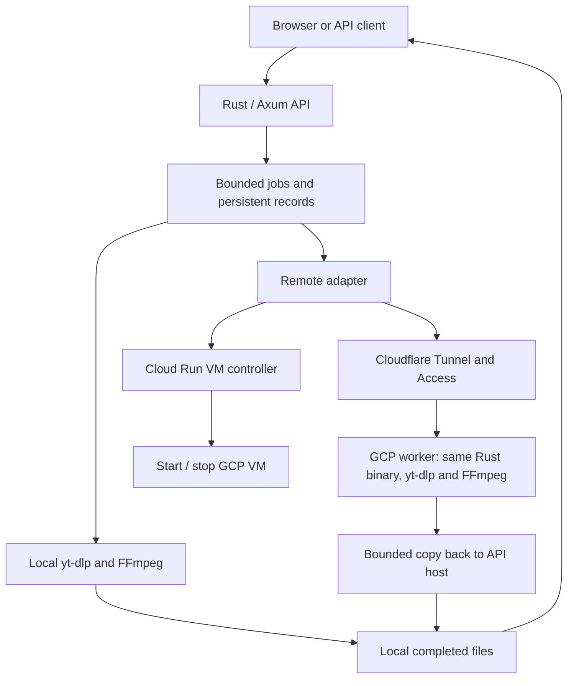

# YouTube Extractor

A small Rust service for getting YouTube video information and downloading audio or
video. It includes an authenticated HTTP API and **Frame**, a browser interface for
configuring video and audio exports. Downloads run in the background, so clients can check their
progress and collect the finished file when it is ready.

Rust and Axum handle the API, jobs and storage. **yt-dlp** handles extraction, and
FFmpeg handles media processing. You can run everything on one machine or keep the
API on Railway and send extraction work to an on-demand GCP worker.

Use it with media you own or have permission to download. YouTube availability
depends on the video and the server's network; a healthy service does not guarantee
that a particular video can be retrieved.

## Getting started

For a local build, install the toolchain in `rust-toolchain.toml`, FFmpeg/ffprobe,
Python 3 with venv support, and a JavaScript runtime. This example uses Node.js 22+
(the Docker image includes Node.js 24):

```bash
python3 -m venv work/venv
work/venv/bin/pip install 'yt-dlp[default]==2026.10.21'
cp -n .env.example .env
# Edit .env and set API_TOKEN to a strong random secret, at least 32 characters.
# For example, generate one with: openssl rand -hex 32
set -a
source .env
set +a
export YTDLP_PATH="$PWD/work/venv/bin/yt-dlp"
export YTDLP_JS_RUNTIME=node
cargo run --locked
```

The service does not load `.env` automatically. The local environment above lives
under ignored `work/`; keep `.env` out of commits. Open `http://localhost:8080/` and enter the same `API_TOKEN` under
**API access token**.

`YTDLP_JS_RUNTIME` defaults to `deno` in the application. Set it to `node` when using
Node, including when running the root Docker image. The GCP setup installs Deno
and uses `YTDLP_JS_RUNTIME=deno`.

### Using the browser

Paste a YouTube link, choose video or audio, and set the format and quality.
Select **Review source** to open the YouTube confirmation preview. Extraction
starts only when you choose **Start export**. MP4 is the default; WebM, original
video, MP3, M4A, and original audio use the existing API options. Video resolution
settings are ceilings; available sources determine the result. Audio also allows
an optional bitrate from 32 to 320 kbps. The current extraction adapter uses MP4
and M4A for its original/default video and audio choices; Frame labels those
defaults explicitly. Audio source quality is best available.

Frame follows the accepted job, displays honest progress, and offers a preview
and file download after completion. Cancel queued or running work directly. If a
network error interrupts status checks or cancellation, use **Check job** or
**Cancel job** for the existing job. Light and dark themes share the same layout;
the display preference and saved browser access are retained between visits.

Enter the token once under **API access token** and select **Save access**.
Frame remembers this browser in a Secure, HttpOnly cookie and automatically
restores access on later visits. The token field stays hidden while saved access
is valid. Use **Forget this browser** to clear it. The cookie lasts up to one year;
clearing cookies, expiry, or rotating the server token requires entering it again.

The raw token is not saved in local storage or a JavaScript-readable cookie,
and is never sent to YouTube. This is a trusted operator interface: anyone with
the shared credential can access all jobs and files. Use HTTPS for hosted access.
Completed preview loads the file into a browser Blob, so large files also need
room in browser memory.

## API

Protected `/api/v1` routes accept `Authorization: Bearer <API_TOKEN>` or the
saved browser session. `/health` and browser assets (`/`, `/app.css`, `/app.js`)
are public. File links still require authentication; they are not public share
links. `/api/v1/session` checks, creates, or clears saved browser access; see
[the session contract](docs/api.md#saved-browser-access).

| Method | Endpoint | What it does |
| --- | --- | --- |
| `GET` | `/health` | Check local readiness (`200` or `503`) |
| `POST` | `/api/v1/videos/info` | Get video metadata and available format descriptors |
| `POST` | `/api/v1/downloads` | Queue a download; returns `202` and a job record |
| `GET` | `/api/v1/downloads/{job_id}` | Get status, progress, output details and errors |
| `GET` | `/api/v1/downloads/{job_id}/file` | Download a completed file |
| `DELETE` | `/api/v1/downloads/{job_id}` | Cancel/delete a job; returns `204` |
| `GET` | `/api/v1/internal/activity` | Internal worker activity and boot identity for lifecycle management |

The service accepts watch, `youtu.be`, Shorts and `/live/` video links. A recognized
link does not guarantee the content is downloadable. Playlists and arbitrary URLs
are outside the API's scope.

### Create and collect a download

Load the service token into your shell, then choose a video you are permitted to
retrieve. The examples use `jq` to build JSON and read the job ID.

```bash
export BASE_URL='http://localhost:8080'
export VIDEO_URL='https://www.youtube.com/watch?v=VIDEO_ID'
: "${API_TOKEN:?Load the service API_TOKEN first}"

# Optional: inspect the video before creating a job.
jq -n --arg url "$VIDEO_URL" '{url: $url}' |
  curl --fail-with-body -sS "$BASE_URL/api/v1/videos/info" \
    -H "Authorization: Bearer $API_TOKEN" \
    -H 'Content-Type: application/json' --data-binary @- | jq .

# Create a 720p-or-lower MP4 job.
JOB_JSON=$(jq -n --arg url "$VIDEO_URL" \
  '{url: $url, type: "video", format: "mp4", quality: "720p"}' |
  curl --fail-with-body -sS "$BASE_URL/api/v1/downloads" \
    -H "Authorization: Bearer $API_TOKEN" \
    -H 'Content-Type: application/json' --data-binary @-) || exit 1
JOB_ID=$(printf '%s' "$JOB_JSON" | jq -er '.job_id') || exit 1

# Repeat about every five seconds until the job reaches a terminal state.
curl --fail-with-body -sS "$BASE_URL/api/v1/downloads/$JOB_ID" \
  -H "Authorization: Bearer $API_TOKEN" | jq .

# Run after status is "completed".
curl --fail -sS "$BASE_URL/api/v1/downloads/$JOB_ID/file" \
  -H "Authorization: Bearer $API_TOKEN" --output video.mp4

# Optional: remove the retained job and file when finished.
curl --fail -sS -X DELETE "$BASE_URL/api/v1/downloads/$JOB_ID" \
  -H "Authorization: Bearer $API_TOKEN"
```

For audio, use the same creation endpoint with this body:

```json
{"url":"https://www.youtube.com/watch?v=VIDEO_ID","type":"audio","format":"mp3","quality":"best","audio_bitrate_kbps":128}
```

| Option | Supported values |
| --- | --- |
| Video format | `original`, `mp4`, `webm` |
| Audio format | `original`, `m4a`, `mp3` |
| Video quality | `best`, `worst`, or a height such as `720p` or `1080p` |
| Audio quality | `best`, `worst` |
| Audio conversion bitrate | `32`–`320` kbps; audio jobs only |

A video height is a ceiling, not a promise of that resolution. Available streams
and compatible codecs determine the result. `quality` and `audio_bitrate_kbps` are
optional; unknown request fields are rejected.

Jobs move through `queued`, `running`, then `completed`, `failed` or `cancelled`.
Status responses include `job_id`, timestamps, `progress`, `output`, `error` and a
relative `download_url` when complete. Total bytes and percentage can be unknown.
`202` means accepted, not downloaded. A failed job's `error.code` and `error.message`
explain what happened, even when the status request itself returns `200`.

Ordinary API errors use `{"error":{"code":"...","message":"..."}}`. Common
causes include invalid input (`400`), a missing/wrong token (`401`), upstream access
restrictions (`403`), missing jobs/files (`404`), rate limits (`429`) and exhausted
admission capacity (`503`). Back off on temporary pressure; repeated retries do not
resolve an access restriction. See [the API reference](docs/api.md) for response
examples and the complete error table.

## Architecture overview



**Local mode** (`EXTRACTOR_MODE=local`, the default) does extraction and processing
on the API host. The active adapter is `src/ytdlp.rs`; the native parser and transfer
modules remain for regression coverage and are not the active extraction engine.

**Remote mode** keeps the API, job records and completed files on Railway. A
separately provisioned Cloud Run controller starts a configured Compute Engine VM.
The API reaches its worker through Cloudflare Tunnel/Access, submits work, polls it,
and copies the result back before marking the public job complete. Metadata
requests also use the worker and may need to wait for startup.

The GCP worker defaults to **direct outbound access**, with Deno for yt-dlp's
JavaScript runtime. WARP is an optional, separately validated proxy configuration;
it is not required by the current worker setup. Cloudflare Tunnel protects inbound
traffic and does not provide the worker's outbound route.

Jobs and files live under `DATA_DIR`. Use one API replica and persistent storage;
there is no distributed queue, shared database or object-storage backend. After a
restart, eligible unexpired queued jobs with saved requests can be replayed if
queue space is available. Running jobs become `DOWNLOAD_INTERRUPTED`; retained
completed files remain available on the same volume until expiry. Downloads do not
resume transparently after a restart.

## Deployment

### Docker or Railway

The root `Dockerfile` includes the Rust binary, yt-dlp **2026.10.21** with its EJS
scripts, Node.js **24**, Python and FFmpeg. It runs as UID/GID `10001:10001`.

```bash
docker build -t youtube-extractor:local .
docker volume create youtube-extractor-data
: "${API_TOKEN:?Export a strong API_TOKEN first}"
docker run --detach --name youtube-extractor --restart unless-stopped \
  --publish 127.0.0.1:8080:8080 \
  --env API_TOKEN --env DATA_DIR=/data --env YTDLP_JS_RUNTIME=node \
  --mount type=volume,src=youtube-extractor-data,dst=/data \
  youtube-extractor:local
```

Use an HTTPS reverse proxy for public access. On Railway, build from the repository
root using the supplied `railway.toml`, set `API_TOKEN`, `DATA_DIR=/data` and
`YTDLP_JS_RUNTIME=node`, and mount a persistent volume at `/data`. Railway supplies
`PORT`. Keep one replica and ensure the volume is writable by UID/GID `10001`.
Size the disk above the logical storage budget to leave filesystem headroom.

### On-demand GCP worker

Set `EXTRACTOR_MODE=remote` on the API host and configure:

| Variable | Purpose |
| --- | --- |
| `GCP_CONTROLLER_URL` | HTTPS origin of the separately deployed VM controller |
| `GCP_CONTROLLER_TOKEN` | Separate controller secret, at least 32 visible ASCII characters |
| `GCP_WORKER_URL` | HTTPS origin of the Cloudflare-protected worker |
| `GCP_WORKER_TOKEN` | Matches the worker's own `API_TOKEN`; separate from the public API token |
| `CF_ACCESS_CLIENT_ID`, `CF_ACCESS_CLIENT_SECRET` | Cloudflare Access service-token credentials |
| `GCP_IDLE_TIMEOUT_SECS` | Idle shutdown delay; default `300` |
| `GCP_START_TIMEOUT_SECS` | Worker startup budget; default `300` |
| `GCP_MAX_JOB_ATTEMPTS` | Extraction attempts including the first; default `2`, allowed `1`–`3` |

Controller and worker URLs must be HTTPS origins without paths, queries or embedded
credentials. Railway sends `X-Controller-Token` to the controller; it does not hold a
Google service-account key. The controller needs an attached identity allowed to
inspect/start/stop its configured VM. Its implementation is not included here.

The worker runs in local mode, bound to loopback behind `cloudflared`. Follow
[the worker setup guide](gcp-worker/README.md) for packaging, Ubuntu/systemd setup,
controller responses and upgrades. Idle shutdown is best effort; maintain an
independent VM maximum-runtime stop policy. Railway stops only a VM it started,
after the configured idle interval (five minutes by default, checked every 15
seconds). A manually started VM stays under manual control. Ownership is tied to
the worker's boot identity and persists until shutdown is confirmed; an accepted
stop request alone does not clear it. Stopped VMs can still incur disk and other
provisioned-resource costs.

### Configuration and troubleshooting

[`.env.example`](.env.example) lists the common settings. These defaults are useful
starting points; adjust them to your machine and workload:

| Setting | Default | Meaning |
| --- | --- | --- |
| `API_TOKEN` / `ALLOW_UNAUTHENTICATED` | Required / `false` | Keep authentication enabled outside deliberate local development |
| `PORT` / `BIND_HOST` | `8080` / `0.0.0.0` | Listener address |
| `DATA_DIR` | `data` (Docker: `/data`) | Job records, temporary work and finished files |
| `WORKERS` / `QUEUE_CAPACITY` / `MAX_JOBS` | `2` / `16` / `256` | Active jobs, waiting jobs and retained records |
| `MAX_DOWNLOAD_BYTES` | 1 GiB | Per-job media workspace budget |
| `MAX_STORAGE_BYTES` | 8 GiB | Logical reservations and retained-output budget |
| `JOB_TTL_SECS` | `3600` | Terminal-job retention in seconds |
| `REQUESTS_PER_MINUTE` / `MAX_CONCURRENT_REQUESTS` | `120` / `32` | Shared API request limits, including polling and files |
| `CONNECT_TIMEOUT_SECS` / `REQUEST_TIMEOUT_SECS` | `10` / `30` | General connection setting / API handler deadline; remote transport has separate limits |
| `DOWNLOAD_TIMEOUT_SECS` / `STALL_TIMEOUT_SECS` | `1800` / `180` | Job deadline / yt-dlp no-file-growth timeout |
| `YTDLP_PATH` / `YTDLP_JS_RUNTIME` | `yt-dlp` / `deno` | Extractor executable and JavaScript runtime |
| `YTDLP_PROXY` / `YTDLP_PROXY_REQUIRED` | Unset / off | Optional server-configured proxy / require local WARP readiness |
| `RUST_LOG` | `info` | Structured service log filtering |
| `FFMPEG_PATH` / `FFPROBE_PATH` | `ffmpeg` / `ffprobe` | Media tool executables |

Storage reservations can reject jobs before the queue fills. Allow space for source
files and output to coexist during processing. Cold remote metadata requests can
exceed the default 30-second API handler deadline; set `REQUEST_TIMEOUT_SECS` and
client/proxy deadlines to cover the expected startup time when needed.

If `/health` returns `503`, check writable storage and FFmpeg/ffprobe. On workers
with `YTDLP_PROXY_REQUIRED=true`, readiness also checks the local SOCKS listener and
WARP connection status. Health does not contact YouTube, validate remote controller
access or prove an end-to-end download works.

For controller failures, inspect the method, path, HTTP status and hint in the job
error and correlate its `job_id` with `youtube_extractor::remote` logs. Keep tokens,
headers, signed media URLs and private video links out of shared logs. Older
architecture/operations notes include WARP-specific setups; use the current worker
environment example and setup script for the default direct-egress configuration.

## Development and verification

```bash
cargo fmt --all -- --check
cargo clippy --locked --all-targets -- -D warnings
cargo test --locked --all-targets
node --check web/app.js
node --test tests/frontend/*.test.mjs
python3 evals/run.py --out work/evals
```

Deterministic tests use fixtures, synthetic subprocesses, media and loopback HTTP.
The [eval guide](evals/README.md) explains scenario selection and reports. CI also
builds the Docker image and runs `scripts/smoke-container.sh` for health and
authentication checks. These checks do not establish live YouTube access.

For live verification, select an authorized test video, export `BASE_URL`,
`API_TOKEN`, `YOUTUBE_TEST_URL` and `ALLOW_EXTERNAL_YOUTUBE=1`, then run
`bash scripts/smoke-youtube.sh` (or `bash scripts/smoke-railway.sh`). The script checks
metadata and real MP3/MP4 files with `ffprobe`. Historical results in
[docs/test-results.md](docs/test-results.md) describe earlier revisions, not current
deployment acceptance.

For contributor guidance, see [AGENTS.md](AGENTS.md). The [API reference](docs/api.md),
[architecture notes](docs/architecture.md) and [deployment guide](docs/deployment.md)
provide further implementation and operational context.
