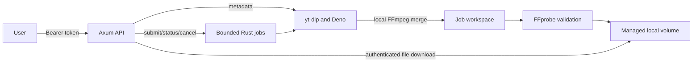

# Architecture and operational assumptions

This is one independently deployable Rust/Axum service. In the production path,
a managed `yt-dlp` subprocess handles YouTube extraction, stream transfer and
FFmpeg-based merge/extraction. Deno provides the maintained EJS runtime; Rust
handles bearer authentication, URL normalization, job admission and queue,
cancellation, workspace byte budgets, FFprobe output checks, storage and file
delivery. The former native parser/downloader is retained as testable legacy
code but is not the production job executor.

## Workload and reliability assumptions

The initial service trusts one owning application represented by a shared bearer
token. All authenticated callers can inspect and cancel all jobs. It is not a
shared multi-tenant API: tenant isolation requires separate credentials,
ownership checks, and storage partitioning before exposing it to unrelated users.
Public media is the intended content tier. API credentials, signed upstream
URLs, and private job metadata are internal data and must not enter responses or
logs. The caller remains responsible for authorization to download each video.

There is no measured read/write ratio or one-year p99 QPS forecast yet. Metadata
lookups run synchronously; downloads are asynchronous. The initial limits are
two concurrent media jobs, sixteen queued jobs, 256 retained job records, one GiB
per job for combined source and output files, eight GiB total storage, and 120
API requests per minute. Admission reserves one full job budget for each queued
or running job and counts actual completed output sizes; storage capacity may
therefore reject admission before the queue reaches sixteen. These are conservative
starting resource budgets, not measured capacity commitments. Polling creates
reads in proportion to job duration and client interval. Start with five-second
polling and back off when queued.

The provisional control-plane latency targets are p50 20 ms, p95 80 ms, and p99
200 ms for authentication, job submission, and status responses, excluding
metadata network access, media transfer, filesystem stalls, and FFmpeg. The
availability objective is 99.9% per calendar month for the authenticated local
API. These targets are unverified until deployment measurements exist. The
service owner is the provisional error-budget consumer; a named human owner and
traffic forecast must be assigned before a contractual SLO is approved.

RPO depends on the persistent volume and its backup schedule; no zero-loss
claim is made. An initial RTO target is 30 minutes after restoring the image and
volume. Owner approval, a backup policy, and a restore exercise are outstanding.
The container filesystem is never considered durable. Railway must mount a
persistent volume at `DATA_DIR` if job records or completed files must survive
restarts. Volume loss without a backup loses those records and files. Local
storage requires a single replica per volume; independent replicas do not share
the in-process queue. A shared database/queue and object storage are necessary
before horizontally scaling one shared job namespace.

## Boundaries

| Module | Responsibility |
| --- | --- |
| `api` | Versioned HTTP contract, authentication, request validation and limits, file delivery |
| `config` | Startup validation of secrets, timeouts, concurrency and retention budgets |
| `error` | Stable machine error codes and JSON error responses |
| `model` | Public metadata, requests, formats, and job response types |
| `extractor` | URL normalization; legacy native parser retained for fixtures |
| `network` | Legacy native transport; yt-dlp now owns its upstream HTTPS requests |
| `download` | Legacy native streaming and shared progress types |
| `media` | Local-file FFprobe validation; yt-dlp invokes FFmpeg for remuxing |
| `ytdlp` | Managed extractor subprocess, safe argument construction, bounded workspace monitoring, output verification |
| `storage` | Managed local paths, completed output, cleanup and durable local records |
| `jobs` | Admission, bounded execution, state transitions, cancellation and retention |

The common extractor trait keeps metadata independent from the Axum API.
The production implementation delegates extraction and transfer to yt-dlp.
Every supplied URL is normalized into a single YouTube video ID and reconstructed
before crossing the subprocess boundary. No shell interpolation or user-derived
output paths are used. Metadata format URLs are deliberately omitted from API
serialization. yt-dlp and Deno remain external processes that must be sandboxed
with container CPU, memory and PID limits.

## Job and resource lifecycle

Requests are validated before queue admission. A full queue returns a structured
backpressure error instead of growing memory. Jobs transition from queued to
running and then to completed, failed, or cancelled. Terminal jobs have a finite
retention period. Cancellation propagates to network transfers and child
processes; partial files are removed. Completed files are served using streaming
bodies rather than loading the artifact in memory. File names are derived from
server-generated job identifiers, never supplied as filesystem paths by callers.

The byte budget, timeouts, worker count, retention count and queue capacity must
be tuned together. Budget disk for retained outputs and active source files;
muxing can temporarily require both source streams and an output artifact.
FFmpeg threads and codecs can consume significant CPU even when network buffers
are bounded. Request limits do not replace the background worker limit.

Graceful shutdown stops admissions and cancels active work before process exit.
After restart, interrupted jobs must become terminal with an honest interruption
error; replaying extraction without caller awareness could duplicate work. The
operational docs and implementation tests define the exact persistence behavior.
Optional S3-compatible completed-output storage is a future extension unless an
adapter and signed delivery have been implemented and tested. Its configuration
must not falsely imply support merely because environment variables exist.

## Security and protocol limits

Only supported YouTube URL shapes are accepted as user destinations. Upstream
media must use approved HTTPS domains. DNS answers and redirect destinations
require validation; private and special-purpose addresses are rejected. Redirects
must not silently route a signed URL to arbitrary hosts. No user cookies or
upstream authentication secrets are accepted. FFmpeg only receives local media
paths and constrained arguments.

Direct accessible streams are the first supported path. Signature-ciphered
streams, throttling transforms, DRM, live manifests, authenticated videos, and
challenged responses require explicit supported handling or typed unsupported /
access-restricted errors. There is no extraction library fallback. A watch page
that loads is not evidence that its media URL is usable from Railway.

Error codes distinguish DNS/network failure, platform access restriction,
upstream rate limiting, player changes, unsupported formats, expired URLs,
interrupted transfers, byte-limit violations, timeouts, and FFmpeg failure.
Never log full upstream response bodies, bearer headers, or signed URLs.

## Verification and release gates

Deterministic tests use controlled HTTP/media fixtures for parser changes,
format selection, transfer interruption, byte caps, queue saturation,
cancellation, restart recovery, API errors, and FFmpeg output. External YouTube
tests are opt-in and must use authorized media. Successful fixtures do not prove
current YouTube compatibility.

A production release additionally requires a built container, an authenticated
runtime smoke test, and authorized metadata plus actual audio/video download
tests from Railway. Datacenter IP restrictions are an external risk: using Rust
does not fix them. Return a clear restriction if access is denied; do not rotate
proxies, bypass CAPTCHA, inject stolen cookies, or circumvent DRM. Record what
was actually tested in the verification report and retain unperformed checks as
explicit release gaps.
