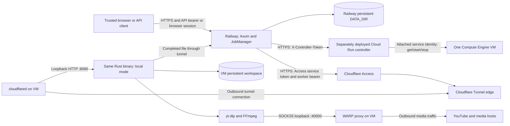

# Architecture: local extraction and an on-demand GCP worker

This branch has two execution modes selected in [`src/main.rs`](../src/main.rs).
`EXTRACTOR_MODE=local` runs the managed yt-dlp adapter in the API process's host.
`EXTRACTOR_MODE=remote` keeps the browser UI, public API, job records and completed
files on Railway, and delegates extraction to the same Rust binary on a Compute
Engine VM. The default is local mode. The active extractor is
[`src/ytdlp.rs`](../src/ytdlp.rs), with yt-dlp 2026.10.21, its packaged EJS scripts,
Node.js and FFmpeg. The native player parser and Rust transfer pipeline remain
available to regression tests; `rusty_ytdl` is not the production backend.

This document describes repository behavior and the infrastructure contract. It
does not establish that a Cloud Run controller, VM, tunnel, WARP registration or
Railway deployment is currently configured or healthy. The repository ships the
worker installer and controller client, **not a Cloud Run controller service or
GCP/Cloudflare infrastructure provisioning**. Use the
[GCP and Cloudflare operations guide](gcp-cloudflare-operations.md) for setup and
verification, and the [worker guide](../gcp-worker/README.md) for bundle installation.

## Deployment and network paths

The VM contains the worker, `cloudflared` and `warp-svc`; the arrows show
connections, not a requirement for inbound connections to the VM. These are
three separate paths:

| Path | Purpose | Authentication and exposure |
| --- | --- | --- |
| Railway → Cloud Run → Compute Engine | Inspect and change the power state of one configured VM | Application `X-Controller-Token`; Cloud Run's attached service identity calls Compute Engine |
| Railway → Cloudflare Access/Tunnel → worker | Health, metadata, dispatch, progress, file transfer and cancellation | `CF-Access-Client-Id` / `CF-Access-Client-Secret` at the edge; a separate `Authorization: Bearer` token at the worker API |
| yt-dlp → local WARP SOCKS proxy → YouTube | Worker outbound extraction traffic | Operator-managed WARP registration; no caller-supplied proxy or YouTube cookies |

Cloudflare Tunnel provides inbound application reachability through an outbound
connector. WARP provides the configured outbound proxy for yt-dlp. Installing
one does not configure or authenticate the other. The worker template binds
`127.0.0.1:8080`; WARP proxy mode listens at `127.0.0.1:40000`. Neither port should
be exposed by a GCP VPC firewall or public container port mapping. The stable
worker hostname must be protected by Access, including `/health` and all API
paths. Tunnel connectivity alone is not an authorization policy.

In local mode there is no controller or worker HTTP hop. The API submits to a
local `YtDlp` executor, which downloads, merges/converts and probes files on the
same host. The production Dockerfile does not install or configure WARP. It is
not evidence that Railway's direct YouTube egress works. The legacy
`SafeHttpClient` host/DNS checks do not wrap yt-dlp's own socket requests;
production yt-dlp egress relies on its configured proxy and infrastructure policy.

## Identity and trust boundaries

The service is a trusted single-operator tool. Its shared public `API_TOKEN`
grants access to all jobs and files. The browser exchanges it for an opaque,
signed HttpOnly session cookie; see [browser access](browser-access.md). There
is no tenant ownership boundary between holders of that token. Keep these
credentials distinct:

| Credential | Stored by | Sent to |
| --- | --- | --- |
| Public `API_TOKEN` | Railway and authorized clients | Railway `/api/v1` routes |
| `GCP_CONTROLLER_TOKEN` | Railway and controller secret configuration | Controller only, as `X-Controller-Token` |
| `GCP_WORKER_TOKEN` / worker `API_TOKEN` | Railway / VM root-owned environment file | Worker bearer-protected routes |
| Cloudflare Access service token | Railway / Cloudflare Access policy | Worker hostname only |
| Cloudflare Tunnel credential | VM connector configuration | Cloudflare tunnel service |
| WARP registration | VM client state | WARP service |
| Cloud Run runtime service identity | GCP | Compute Engine API; no private key on Railway |

The controller must authenticate its application token before any VM operation,
bind the project/zone/instance in its own configuration, and reject attempts to
select arbitrary targets. Its attached runtime service account needs narrowly
scoped `compute.instances.get`, `compute.instances.start` and
`compute.instances.stop`. Railway sends no Google IAM identity token: Cloud Run
invocation/ingress settings must permit this request path while the controller
still enforces its own authentication. A default Cloud Run service requiring an
IAM identity token will reject this client. Cloud Run invoker permission and
Compute Engine runtime permissions are separate controls.

[`src/remote.rs`](../src/remote.rs) validates configured controller and worker
URLs as HTTPS origins, rejects redirects, and uses fixed relative routes. Worker
credentials do not accompany controller requests, and controller credentials do
not accompany worker requests. Controller bodies are untrusted and its status
body is capped at 16 KiB. Worker replies use the shared `JobView` model: dispatch
and status must identify the expected UUID and contain known typed states. The
consumer does not use a returned download URL or path to choose its destination;
it constructs the authenticated file route and publishes under local UUID paths.
Never log secrets, raw upstream bodies or signed media URLs.

## Controller and worker contracts

Every controller request carries `X-Controller-Token`:

| Method/path | Required response | Meaning |
| --- | --- | --- |
| `GET /status` | `200`, JSON such as `{"status":"RUNNING"}` | Current Compute Engine state |
| `POST /start` | `200` or `202`; `409` for a transient conflict | Already running or start accepted; not application readiness |
| `POST /stop` | `200` or `202`; `409` for a transient conflict | Already stopped or stop accepted |

Lifecycle response bodies are not required. State parsing recognizes
`PROVISIONING`, `STAGING`, `RUNNING`, `STOPPING`, `SUSPENDING`, `SUSPENDED`,
`REPAIRING` and `TERMINATED`. Readiness can start a `TERMINATED` VM, wait through
`STOPPING`, `STAGING`, `PROVISIONING` or `REPAIRING`, and probe a `RUNNING` VM.
Suspended/suspending states are recognized but cannot serve this startup flow;
this design uses stop/start, not suspend/resume. Unexpected HTTP statuses,
unknown states and malformed replies fail the operation.

Worker dispatch is `POST /api/v1/downloads` with `X-Idempotency-Key` set to the
worker UUID. Its normal response is `202` with the same `JobView` shape returned
by `GET /api/v1/downloads/{id}`. `progress` has `downloaded_bytes`, nullable
`total_bytes`, and nullable `percent`; it has no internal `stage` field. Railway
derives a stage from `queued`, `running`, `completed`, `failed` or `cancelled`.
The worker also exposes authenticated `/api/v1/internal/activity` with a boolean
`busy` field for shutdown decisions.

## Execution, retry and shutdown

1. Railway validates a request and persists a queued local job before dispatch.
   Admission reserves one per-job byte budget; the queue, job count and aggregate
   storage limits can reject work before extraction starts.
2. A remote operation holds an activity guard and acquires the in-process
   lifecycle mutex. It polls controller state, requests a start when needed, and
   waits for the worker's `/health`. The mutex serializes startup and stop
   decisions for this Railway process.
3. Dispatch uses Railway's UUID for the first extraction attempt. An uncertain
   HTTP delivery is retried once with the same UUID/idempotency key. This is
   distinct from retrying extraction after a worker has failed.
4. Railway polls worker job state every three seconds. A completed worker result
   is copied over the authenticated file route to Railway storage. Its extension
   must be supported; its declared size must be positive and below the configured
   maximum. Streamed size must exactly match that declaration and remain within
   the byte cap. Partial local transfers are cleaned on failure. Only a fully
   published local file makes the Railway job complete.
5. After a validated dispatch, remote cleanup is attempted with `DELETE` after
   completion, failure or cancellation. It is best effort; worker TTL cleanup is
   still necessary. A lost response, process crash or malformed dispatch reply
   can leave work behind, so exactly-once execution is not guaranteed.
6. The idle watcher checks every fifteen seconds. It requires no local active
   operations, an elapsed idle interval, the lifecycle mutex, VM `RUNNING`, and a
   worker activity reply of `busy: false` before requesting stop. Unknown worker
   activity blocks shutdown. A new operation arriving during a stop waits and
   restarts the same VM. An independent GCP maximum run duration is needed if
   Railway disappears or stop requests fail.

`GCP_MAX_JOB_ATTEMPTS` defaults to 2 (range 1–3). A retryable
`DOWNLOAD_INTERRUPTED` result gets a fresh worker UUID, while the local Railway
job ID stays stable. Network/contract errors, queue-full results and cancellation
are not generically retried. **The current remote consumer maps every worker
`failed` state to `DOWNLOAD_INTERRUPTED`, discarding the worker's original error
code**, so a worker access restriction or local timeout may also consume this
bounded retry. Metadata non-success HTTP responses map to `ACCESS_RESTRICTED`;
that code alone cannot distinguish an Access policy rejection from a YouTube
restriction. Use correlated logs and the failing layer when diagnosing either.

## Time budgets and readiness

| Budget | Implemented behavior |
| --- | --- |
| `GCP_START_TIMEOUT_SECS` | Default 300; range 60–900; bounds readiness polling and its in-flight HTTP calls after the lifecycle lock is acquired |
| Controller HTTP | 10-second connect, 45-second whole request; no redirects |
| Worker readiness | Seven-second health request bound; lifecycle polling every five seconds |
| Worker HTTP client | 10-second connect, 1800-second whole request; no redirects |
| Remote file transfer | 60-second next-chunk bound, plus worker HTTP and outer job deadlines; no byte-range resume |
| `DOWNLOAD_TIMEOUT_SECS` | Default 1800 at each service; bounds its own job execution, including cold startup on Railway |
| `REQUEST_TIMEOUT_SECS` | Default 30; bounds API handlers before the response is returned, including synchronous metadata |
| `STALL_TIMEOUT_SECS` | yt-dlp workspace growth check, default 180; valid values 30–1800, otherwise defaults to 180 |
| `GCP_IDLE_TIMEOUT_SECS` | Default 300; range 60–3600; elapsed idle time plus watcher scheduling and HTTP time |

Increasing one timeout does not change the others. In particular, synchronous
metadata can exceed Railway's default request deadline during a cold start;
queueing a download returns promptly and moves startup into background work.
Lifecycle lock waiting, provider time, worker queues, file copy, and client/edge
request limits must fit the selected operation's outer budget. A longer
`DOWNLOAD_TIMEOUT_SECS` does not increase the remote client's fixed 1800-second
HTTP deadline. Tunnel or reverse-proxy limits may impose another independent
ceiling. The service does not promise that an abandoned metadata request stops
all upstream work immediately.

`/health` checks configuration, writable local disk and FFmpeg/FFprobe. With
`YTDLP_PROXY_REQUIRED=true`, it also checks the local SOCKS listener and
`warp-cli status`. It does not verify a working SOCKS negotiation, yt-dlp/EJS
compatibility, an authenticated end-to-end tunnel path, or actual YouTube media
access. Railway's own healthy response does not wake or validate the GCP worker.
Readiness results are cached briefly. Test each network path separately.

## Persistence, capacity and availability

There are two independent bounded queues and two storage budgets: Railway's and
the VM's. Railway `WORKERS` limits concurrent remote operations; worker `WORKERS`
limits actual extractions. Forwarding five operations to a two-worker VM does
not create five extraction slots. Each service reserves a full
`MAX_DOWNLOAD_BYTES` budget for active/queued jobs and counts retained output
against `MAX_STORAGE_BYTES`; disk headroom and OS resource limits remain needed.

Keep one Railway replica and one worker process on the configured VM. The
lifecycle lock, activity tracking, rate limiter and idempotency state are local,
not distributed leases. Two Railway replicas can stop each other's VM or
conflict over dispatch. Horizontal scaling requires shared durable coordination,
job ownership and storage before increasing replicas.

[`src/jobs.rs`](../src/jobs.rs) persists records beneath `DATA_DIR/state`.
Restart recovery can requeue unexpired queued records with a stored request when
queue capacity permits. Running jobs are marked interrupted rather than silently
redispatched; cleanup-pending/cancelled records are also handled as interrupted
cleanup. Completed files survive only when the same volume and valid output are
retained. This is not transparent resume of remote jobs or partially copied
bytes. VM stop preserves a persistent disk, not an in-flight process. Do not
assume graceful cleanup when a hard run-duration limit fires.

The workload remains single-operator and has no measured traffic forecast or
capacity benchmark. Existing provisional control-plane targets are p50 20 ms,
p95 80 ms, p99 200 ms, excluding metadata, media, filesystem stalls and FFmpeg;
99.9% monthly API availability and a 30-minute restore target remain unverified
planning targets. RPO depends on an approved backup schedule. A named service
owner, measured cold-start distributions and restore exercises are required
before treating these as commitments. Retention is not backup, and a stopped VM
still incurs persistent-disk and potentially reserved-address costs.

## Verification boundaries

Deterministic tests and [evals](../evals/README.md) exercise input contracts,
controller/worker fixtures, lifecycle failures, cancellation and bounded media
handling. They establish behavior against controlled inputs. A live acceptance
run must separately establish Cloud Run authentication/IAM, VM boot, WARP egress,
Access/Tunnel routing, metadata, playable audio/video bytes, cancellation and
idle shutdown. Download only authorized media; do not use proxy rotation,
CAPTCHA bypass, stolen cookies or DRM circumvention. Preserve safe errors and
report the failing layer when an upstream or network policy denies access.
